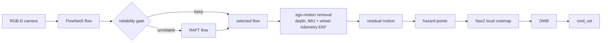

# RAPID-NAV

*Reliability-Aware Perception for Intelligent Dynamic Navigation*

[](https://github.com/harsh-vsharma/rapid-nav/actions/workflows/ci.yml)

A differential-drive mobile robot in Gazebo that uses optical flow to see which things move. Fast flow (FlowNetS) is
used by default, and accurate flow (RAFT) is used when a reliability check fails. The robot's own motion is removed
with depth, the IMU and wheel odometry, and the remaining motion becomes hazards in the Nav2 local costmap.

A project for AR522 Robot Vision and AR511 Autonomous Mobile Robots at CAIR, IIT Mandi.

## Status

The robot, the simulation, the optical flow, the global planning (localisation on the map, the planner server with
our planners), the local control (Nav2's controller and behaviour servers, with our dynamic window controller) and the
moving obstacles with their scenarios are in testing; the other parts are planned.

| Part | Stage | Status |
|---|---|---|
| Robot and simulation | S1 | in testing |
| Perception | S2 | in testing |
| Ego-motion compensation | S3 | planned |
| Dynamic scenarios: moving obstacles and the geometry baseline | S4 | in testing |
| Navigation baseline: global planning | S5 | in testing |
| Local control: our DWA, DWB and RPP, goal runs on ground truth | S6 | in testing |
| Hazard layer: velocity-aware costmap from tracked obstacles (oracle source) | S7 | in testing |
| Camera-based obstacle tracks: the flow source of the hazard layer | S3 | in testing |
| Adaptive flow | S8 | planned |
| Experiments | S9 | planned |

## Pipeline



See [docs/architecture.md](docs/architecture.md) for the design.

## Repository layout

- `src/`: ROS 2 packages: the robot description, the Gazebo arena and bridge, the launch files, the `sim_check` tool,
  the maps and the navigation launch, our planner (`rapid_nav_planner`) and the planner checks (`planner_check`), our
  controller (`rapid_nav_controller`), and the tools (`rapid_nav_tools`): the checks, the path viewer and `nav_run`.
- `prototypes/`: reference code, not built.
- `docs/`: setup, development and architecture notes.
- `docker/`: optional build-and-test image for machines without a native ROS 2 install.
- `scripts/`: `dev.sh`, which drives the Docker image.

## Requirements

- Ubuntu 24.04
- ROS 2 Jazzy
- Gazebo Harmonic (`ros-jazzy-ros-gz`)

The full steps are in [docs/setup.md](docs/setup.md).

## Quick start

```bash
mkdir -p ~/ros_ws && cd ~/ros_ws
git clone https://github.com/harsh-vsharma/rapid-nav.git
cd rapid-nav
sudo rosdep init   # only once per machine; skip if it says it is already initialised
rosdep update
rosdep install --from-paths src --ignore-src -y
colcon build --symlink-install
source install/setup.bash
```

Start the simulation (Gazebo with the arena and the robot, the odometry and RViz):

```bash
ros2 launch rapid_nav_bringup sim.launch.py
```

Drive the robot with the keyboard, in a second terminal:

```bash
ros2 run teleop_twist_keyboard teleop_twist_keyboard
```

Run the automatic check, in a third terminal (the robot drives by itself, so keep clear of it):

```bash
ros2 run rapid_nav_tools sim_check
```

Start the simulation with the global planning stack (the map, AMCL localisation and the seven planners, with RViz paths
for each goal you click with "2D Goal Pose"):

```bash
ros2 launch rapid_nav_bringup sim.launch.py planning:=true
```

Start the navigation stack (the planning stack, Nav2's controller, behaviour and BT navigator servers, and our DWA
controller; `controller:=dwb` or `controller:=rpp` chooses the others). Click a goal with "2D Goal Pose" in RViz:

```bash
ros2 launch rapid_nav_bringup sim.launch.py navigation:=true
```

With the stack running, run a goal scenario and score it on the simulator's ground truth, in a second terminal:

```bash
ros2 run rapid_nav_tools nav_run --scenario tour --controller dwa
```

Add moving obstacles (a person who crosses the robot's path, one who comes head-on, a small crowd) with the `scenario:=`
argument (`crossing`, `head_on` or `crowd`), then run the same scenario:

```bash
ros2 launch rapid_nav_bringup sim.launch.py navigation:=true scenario:=crossing
ros2 run rapid_nav_tools nav_run --scenario crossing --controller dwa
```

Add `hazards:=oracle` to the launch (and `--hazards oracle` to `nav_run`) to paint the predicted positions of the obstacles
into the costmaps from their true velocities, or `hazards:=oracle_static` for their current positions only. With `hazards:=flow` the velocities come from the robot's own
camera instead (RAFT flow, the robot's motion removed with depth and TF); the simulation then runs at a quarter of real
time (`rtf:=0.25`, `--rtf 0.25` for `scripts/dev.sh`) so that the flow network keeps up.

The maps, the planners, the controllers and the goal runs are described in [docs/navigation.md](docs/navigation.md); the
steps for the tester are in [docs/sim-checks.md](docs/sim-checks.md) (sections 10 to 15).

Start the optical flow on the camera (Farnebäck always, RAFT when PyTorch is installed; see
[docs/perception.md](docs/perception.md)):

```bash
ros2 launch rapid_nav_bringup sim.launch.py perception:=true flow_backend:=farneback
```

The robot is described in [docs/robot.md](docs/robot.md). The step-by-step check procedure for testers is in
[docs/sim-checks.md](docs/sim-checks.md).

## Team

Rishi Atreya, Kamalesh Kumar B, Jaspinder Kaur, Harsh Vardhan (CAIR, IIT Mandi).

## Licence

MIT, see [LICENSE](LICENSE).
