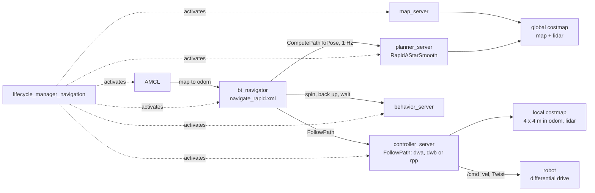

# Navigation

This page describes the navigation stack: the occupancy maps, localisation on the map, the global and local costmaps,
the planner server with our planner plugin (S5), and Nav2's controller and behaviour servers with our dynamic window
controller (S6). It also describes the tools that check them, and the goal runs that score the robot against the
simulator's ground truth.

## The stack



The BT navigator runs one behaviour tree for each `NavigateToPose` goal: `behavior_trees/navigate_rapid.xml`, a copy of
Nav2's tree that replans the path once a second and uses our planner as the default. When a step fails, the tree
clears the costmaps, spins, waits or backs up (the behaviour server). A goal comes from RViz ("2D Goal Pose") or from
the action directly.

`sim.launch.py navigation:=true` starts the whole stack with the simulation, under one lifecycle manager that starts
each server in turn (`autostart`). The argument `controller:=dwa|dwb|rpp` chooses the controller (default `dwa`).
`planning:=true` and `navigation:=true` are not passed together: the navigation stack includes the planning stack.

## Maps

Two maps are committed in `src/rapid_nav_navigation/maps/`:

| map | size | origin (m) | what it is |
|---|---|---|---|
| `arena` | 220 × 180 cells | (-5.5, -4.5) | the arena, rasterised from the collision shapes of its walls, crates and pillars |
| `maze` | 200 × 160 cells | (-5.0, -4.0) | a fixed maze: an outer wall, a divider with a 0.70 m and a 0.45 m door, a U-shaped trap and a dead-end corridor |

Both are 0.05 m per cell, trinary PGM with YAML files that `map_server` reads. The arena map includes the free space
outside the walls; the planner's queries never start or end there.

To regenerate them (the output is deterministic, and `test_maps` checks the committed files):

```bash
uv run --with numpy --with pillow python src/rapid_nav_navigation/scripts/make_maps.py
```

The arena keeps the shapes whose height overlaps the robot's height band (0.02 m to 0.40 m), which drops the floor.
The maze is a list of rectangles in `make_maps.py`; the module docstring draws it.

## Localisation

`planning.launch.py` and `navigation.launch.py` start AMCL (`nav2_amcl`) on the arena map with the differential motion
model and the likelihood field for the laser (`/scan`, 60 beams, 500 to 2000 particles). AMCL starts at the robot's
spawn pose and publishes the `map → odom` transform; `odom → base_footprint` stays with the odometry of S1.

Two modes for the planning stack:

- `localization:=amcl` (default): the simulation. `sim.launch.py planning:=true` starts it with the spawn pose.
- `localization:=static`: no simulation. `map → odom` is the identity and `odom → base_footprint` is the initial pose,
  so the planner can be exercised without Gazebo.

## Costmaps

The global costmap is built from the static map and, in the navigation stack, the lidar obstacle layer. Its resolution
is 0.05 m, its frame is `map`, and it follows `base_footprint`. The obstacle layer reads `/scan` (marking and clearing,
obstacles up to 5.0 m, rays traced to 6.0 m), so an obstacle that is not on the map makes the 1 Hz replanning go round
it. The inflation layer uses the robot radius of 0.25 m as the inscribed radius, an inflation radius of 0.55 m and a
cost scaling factor of 3.0. Cells are lethal when occupied, inscribed within the robot radius, and decay outside it.

The local costmap is rolling: 4 × 4 m around the robot in `odom`, 0.05 m per cell, with the same lidar obstacle layer
(obstacles up to 2.5 m, rays traced to 3.0 m) and an inflation radius of 0.45 m. The controller reads it.

## The planners

The planner server runs seven planners, all of them selectable by `planner_id`:

| `planner_id` | implementation | what it is |
|---|---|---|
| `RapidAStar` | ours | A* on the cost grid, 8-connected, no corner cutting |
| `RapidAStarSmooth` | ours | A*, then greedy shortcutting of the path within 10 % of its cost (the default of the navigation stack) |
| `RapidDijkstra` | ours | Dijkstra on the same grid: the reference for `RapidAStar` |
| `RapidThetaStar` | ours | Theta*: any-angle paths where the straight line between two cells is free |
| `NavFn` | `nav2_navfn_planner` | potential field (stock Nav2) |
| `Smac2D` | `nav2_smac_planner` | 2-D A* with Nav2's cost penalties (stock Nav2) |
| `NavThetaStar` | `nav2_theta_star_planner` | Theta* (stock Nav2) |

Our four planners are one plugin, `rapid_nav_planner/GridPlanner` (`grid_planner_plugin.xml`), created four times with
different `algorithm` parameters.

### How our search works

- **Dijkstra** expands the cheapest cell first. It is optimal and uses no heuristic.
- **A*** is the same search with the octile distance to the goal as the heuristic. Each step costs at least its
  length, so the heuristic never overestimates: A* finds the same optimal cost as Dijkstra with fewer expansions.
- **Theta*** links a neighbour directly to the parent of the cell being expanded when the straight line between them
  is free (checked cell by cell, the supercover of the line). The path is then a set of straight segments, and each
  segment is costed by the length it spends in each cell.
- **Smoothing** (`RapidAStarSmooth`) walks the A* path and joins two points when the straight line between them is
  free and costs at most 10 % more than the original piece.
- **Cost** of entering a cell: its length (1 or √2 cells) times `1 + cost_weight × cost / 252`. Unknown cells count as
  cost 0 and are allowed. Lethal (254) and inscribed (253) cells are blocked.
- A start inside the inscribed zone is allowed (it is treated as free so that the robot can leave); a start on a
  lethal cell or a goal in an obstacle is an error, with the Nav2 codes `START_OCCUPIED` and `GOAL_OCCUPIED`.

The path returned to Nav2 is resampled every 0.05 m, and the search statistics (algorithm, expansions, cost, cells,
time, status) are published as JSON on `/<planner_id>/stats`.

### Parameters

| parameter | default | meaning |
|---|---|---|
| `algorithm` | `astar` | `astar`, `dijkstra` or `theta_star` |
| `cost_weight` | 2.0 | how strongly the inflation cost counts against length |
| `heuristic_weight` | 1.0 | weight of the A* heuristic (1.0 is optimal) |
| `lethal_cost` | 253 | cells at or above this cost are blocked |
| `allow_unknown` | true | whether unknown cells can be searched |
| `smooth` | false | smoothing of the path (`RapidAStarSmooth` sets it) |
| `smooth_tolerance` | 0.1 | allowed extra cost of a shortcut, as a fraction |
| `path_resolution` | 0.05 | spacing of the returned poses (m) |
| `max_planning_time` | 2.0 | the search gives up after this many seconds |

The values are in `src/rapid_nav_navigation/config/planning.yaml` (planning only) and `navigation.yaml` (the stack).

## Controllers

The controller server runs one controller, under the id `FollowPath`. `navigation.yaml` holds three blocks,
`FollowPath_dwa`, `FollowPath_dwb` and `FollowPath_rpp`; the launch copies the one chosen by `controller:=` into
`FollowPath`.

| `controller` | what it is | where it comes from |
|---|---|---|
| `dwa` | the dynamic window approach with our critics (below) | ours: `rapid_nav_controller::DwaController` |
| `dwb` | the dynamic window approach with Nav2's critics for a differential robot | stock Nav2: `dwb_core::DWBLocalPlanner` |
| `rpp` | Regulated Pure Pursuit: it tracks the path geometrically, with no search over motions | stock Nav2: `nav2_regulated_pure_pursuit_controller` |

### Our DWA

The controller is the dynamic window approach of Fox, Burgard and Thrun (1997), in the library `dwa_core`, which has no
ROS dependency (its tests are in `rapid_nav_controller/test`). The plugin wraps it. Each control cycle (20 Hz):

1. **Window.** The speeds reachable in one cycle from the measured velocity, within the robot's limits:
   `v` in [v − a_v·dt, v + a_v·dt] and `w` likewise, with 11 × 21 evenly spaced samples, both edges included.
2. **Rollout.** Each sample is held for 1.5 s, in steps of 0.1 s, along the exact arc it describes.
3. **Reject.** A trajectory is rejected when one of its poses lies on a cell at or above 253 (inscribed), or off the
   local costmap.
4. **Critics.** Each critic is normalised to [0, 1] over the surviving trajectories, then weighted; lower is better.
   - `path_distance` (32): the trajectory's end to the nearest point of the pruned path.
   - `goal_distance` (24): the end to the carrot, the path point one metre (`lookahead`) along the path from the
     robot (the goal when the path ends first).
   - `heading` (10): the difference between the end heading and the path's direction at the carrot.
   - `obstacle` (8): the largest cell cost along the trajectory, over 252.
   - `speed` (4): (v_max − v) / v_max, which prefers moving.
5. **Pick** the lowest weighted sum; a tie goes to the faster trajectory. If none survives, the controller raises
   `NoValidControl`, and the behaviour tree clears the costmaps, backs up or spins.
6. **Rotate first, rotate last.** Far from the goal, when the carrot is more than 0.8 rad off the robot's heading, the
   robot turns in place towards it (v = 0, w proportional to the error, clamped to the window), unless that turn would
   collide. Within 0.15 m of the goal and with a yaw error above 0.25 rad, it turns in place to the goal's yaw. The
   window search alone stalls on these two cases.

The plugin copies the local costmap under its mutex, prunes the global plan to the part ahead of the robot and inside
the local costmap, and publishes the chosen trajectory on `/local_plan`. With `publish_trajectories: true` in the block,
every valid candidate is published on `/trajectories` as markers.

| parameter (`FollowPath_dwa.`) | default | meaning |
|---|---|---|
| `max_vel_x`, `min_vel_x` | 0.5, 0.0 | forward speed limits (m/s); no reversing |
| `max_vel_theta` | 1.5 | yaw rate limit (rad/s) |
| `acc_lim_x`, `acc_lim_theta` | 0.8, 2.5 | acceleration limits (m/s², rad/s²) |
| `controller_frequency` (node) | 20.0 | the control rate; `dt` is its inverse |
| `vx_samples`, `wz_samples` | 11, 21 | samples of the window per axis |
| `sim_time`, `sim_step` | 1.5, 0.1 | the rollout horizon and its step (s) |
| `lookahead` | 1.0 | the carrot's distance along the path (m) |
| `rotate_to_heading_angle` | 0.8 | the error above which the robot turns in place (rad) |
| `rotate_gain` | 1.5 | the proportional gain of the in-place turns |
| `xy_goal_tolerance`, `yaw_goal_tolerance` | 0.15, 0.25 | the goal's tolerances for the turn to its yaw |
| `path_distance_weight` … `speed_weight` | 32, 24, 10, 8, 4 | the critics' weights |
| `lethal_threshold` | 253 | the cost at which a pose is inside an obstacle |
| `transform_tolerance` | 0.2 | the wait for a transform (s) |
| `publish_trajectories` | false | publish every candidate as markers |

### Choosing a controller

Use `dwa` for the claims about our controller. `dwb` is the reference for the same family of method (the stock Nav2
critics, with the same limits). `rpp` is a different family: it follows the path geometrically and does not search
over motions, so it is the comparison that shows what the window search buys, and what it costs. The goal runs below
measure all three on the same scenarios.

## Goal runs: `nav_run`

`nav_run` sends a scenario's goals (`config/nav_scenarios.yaml`) to `/navigate_to_pose` one after another, samples the
robot while each goal runs, and scores each goal against the simulator's ground truth (`/ground_truth/odom`).

Why the ground truth: the wheel odometry and AMCL both believe the robot is where they estimate it, and the robot can
slip, be pushed or collide while they still say it arrived. The team's question is whether a controller reaches the
goal and keeps clear of the obstacles, and only the simulator knows that. Nav2's own verdict is recorded next to the
truth, and every disagreement between the two is counted, because that disagreement is the evaluation problem made
visible.

Per goal:

| measure | how |
|---|---|
| success (truth) | the final ground-truth pose is within 0.25 m and 0.35 rad of the goal |
| success (Nav2) | the action's result status is `SUCCEEDED` |
| time | the simulated seconds from the goal to the result (or to the cancel at 120 s) |
| travelled | the length of the ground-truth track |
| tracking error | the mean distance from the ground-truth track to the plan in force at each sample, that is the plan published last before the sample (the planner republishes about once a second, so the last plan alone covers only the final metres; the literal value is kept as `tracking_error_last_plan_m`) |
| minimum body clearance | the smallest distance between the robot's circle (radius 0.25 m) and the occupied map cells and the scenario's boxes; negative means overlap |
| collision episodes | the number of times the body clearance dropped below 0 m (entries, not samples) |
| recoveries | the number of recoveries reported by the action's feedback |
| odometry drift | how far the wheel odometry's motion over the goal differs from the truth's motion |
| AMCL error | the distance of AMCL's pose from the truth at the end of the goal |

The checks for `dwa`: every goal reached by truth, no collision episode, and a minimum body clearance of at least
0.05 m. The rows for `dwb` and `rpp` are information.

The bundle `nav_run_<scenario>_<controller>_<time>/` holds `environment.txt`, `results.json` (every goal, and the samples
at 10 Hz of simulated time), `summary.md` (the check table and the per-goal table) and `trajectories_<scenario>.png`
(the map, the boxes, the track coloured by speed, the goals numbered and the plans in blue). The `unmapped` scenario
spawns two 0.5 m boxes that are not in the map (`spawn.txt` logs the spawn); restart the launch before each run of it.

```bash
scripts/dev.sh nav-smoke tour dwa          # Docker: starts the stack, runs the scenario, copies the launch log
ros2 run rapid_nav_tools nav_run --scenario tour --controller dwa   # native: with the stack already running
```

## Moving obstacles and dynamic scenarios

Until now every obstacle stood still. The scenarios `crossing`, `head_on` and `crowd` add obstacles that move the same
way in every run, so that a controller can be scored against things that move.

**The obstacle model.** Two shapes, both movable bodies of 1000 kg with a very large tilt inertia, so a push from the robot moves and tips them as little as possible (the robot is pushed instead, which the ground truth records), that never touch the floor: a `person` (a cylinder,
radius 0.20 m, 1.70 m high) and a `cart` (a box, 0.60 × 0.40 × 0.90 m). Gazebo's velocity-control system moves a body at
the velocity it is commanded (in the body's own frame), and the odometry-publisher system publishes its true pose on
`/model/<name>/odometry` at 30 Hz. Gravity is off for these bodies: with gravity on, a body under velocity control
tips over and sinks (measured: it fell from 0.87 m to 0.20 m and moved at 0.33 m/s instead of 0.5 m/s), and with
gravity off it holds its height and its speed to within 0.002 m/s. In a contact test the robot drove into a parked person
at 0.3 m/s for 6 s: the person did not tilt (0.000 rad) and moved 0.1 mm.

**The driver.** `obstacle_driver` (started by `scenario.launch.py`, or by `sim.launch.py scenario:=<name>`) spawns the
scenario's obstacles at the first point of their paths, and moves each one along its path at its speed, with a small
term that pulls it back onto the path, and it levels the body: the commanded velocity is turned into the body frame
with the full orientation, and roll, pitch and yaw are pulled back to zero. It publishes `/scenario/ready` once every
obstacle exists, listens to `/scenario/goal` (which `nav_run` publishes before sending each goal) and to the robot's
ground truth to start an obstacle, and draws the obstacles for RViz on `/scenario/obstacles`. The obstacles' true poses
are for scoring and drawing only: nothing in the navigation stack reads them.

**The scenario format** (`config/nav_scenarios.yaml`; a scenario without `obstacles` works as before):

```yaml
obstacles:
  - name: walker_1          # unique in the scenario, [a-z0-9_]+
    shape: person           # person | cart
    path: [{x: 1.5, y: -2.0}, {x: 1.5, y: 0.8}]   # at least 2 points; the obstacle spawns at the first
    speed: 0.5              # m/s, 0 < speed <= 1.0
    mode: once              # once | back_and_forth | loop
    start:                  # optional; without it the obstacle starts when goal 1 is sent
      goal: 2               # armed when goal 2 (1-based) is sent
      robot_within: 2.2     # optional: then waits until the robot is this close ...
      of: {x: 1.5, y: 0.0}  # ... to this point
```

| scenario | goals | what moves |
|---|---|---|
| `crossing` | staging (-3.5, 0), (3.5, 0), back to (0, 0) | a person crosses the robot's line from the south, starting when goal 2 is sent and the robot is within 2.2 m of (1.5, 0); it walks 0.5 m/s and stops at y = 0.8 |
| `head_on` | staging (-3.5, 0), (3.5, 0) | a person walks the robot's own line the other way, from (4.2, 0) at 0.4 m/s, starting when goal 2 is sent |
| `crowd` | (3.5, 0), (-4, 1), (0, 0) | two persons patrol back and forth (0.3 m/s along y = -0.9, 0.5 m/s along x = 0.8 above y = -0.3) and a cart loops at 0.4 m/s; all move from the start; no two paths meet |

Run them with the launch `scenario:=` argument, which starts the obstacles; `nav_run` then waits for `/scenario/ready`
and exits with status 2 and a message when there is no driver. Restart the launch before each run, because the
obstacles stay in the world.

```bash
scripts/dev.sh nav-smoke crossing dwa      # Docker
ros2 launch rapid_nav_bringup sim.launch.py navigation:=true scenario:=crossing      # native, then in a second terminal:
ros2 run rapid_nav_tools nav_run --scenario crossing --controller dwa
```

**New measures** (per goal, in `summary.md` and `results.json`), taken against the obstacles' true tracks at the same
simulated time: the minimum clearance now covers the map, the boxes and the moving obstacles; `min_clearance_static_m`
and `min_clearance_dynamic_m` split it; `closest_approach_m` is the smallest centre-to-centre distance to any
obstacle; `close_encounters` counts the times the dynamic clearance fell below 0.30 m; collisions are counted on the
combined clearance. The picture shows each obstacle's track in grey with a dot every 2 s, a green ring where the robot
was at each goal's closest approach (when it came within 3 m of an obstacle) and the obstacle's outline at that moment.

**Scenario validity.** A dynamic run is only meaningful if the scenario played out as scripted, so `summary.md` starts
with rows that judge the scenario, not the controller (PASS or FAIL for every controller): an obstacle with a `start`
moved more than 0.5 m; each obstacle stayed within 0.10 m of its path (over the samples where it was not in contact
with the robot); its mean moving speed is within 10 % of the scripted speed; and, for `crossing` and `head_on`, the
robot came within 1.5 m of the walker during goal 2. A further row, "never stalls", fails when an obstacle stands
still for more than a second although the robot is not near it, it has started, it is not finished and it is away from
the corners of its path. The navigation rows of a dynamic scenario are information for every
controller, our DWA included: what the controllers do against moving obstacles is the baseline measured here, and
nothing was tuned for it. The baseline is Nav2 with the standard lidar obstacle layer: it sees geometry and has no
notion of what moves, so a moving obstacle leaves a mark in the costmap until the lidar clears it.

### Baseline results (S4)

Measured as above in the Docker development image on an Apple M1 (an arm64 virtual machine with 8 CPUs and 4.8 GiB),
indicative only; times are simulated seconds. One run per row unless marked repeat. All scenario-validity rows pass in
every row shown.

| scenario | controller | goals reached (truth) | collisions | min dynamic clearance (m) | closest approach (m) | close encounters | recoveries | mean time per goal (s) |
|---|---|---|---|---|---|---|---|---|
| crossing | dwa | 3/3 | 1 | -0.052 | 0.40 | 3 | 6 | 14.5 |
| crossing | dwa (repeat) | 3/3 | 1 | -0.052 | 0.40 | 2 | 3 | 13.3 |
| crossing | dwb | 3/3 | 1 | -0.052 | 0.40 | 2 | 1 | 13.9 |
| crossing | rpp | 3/3 | 0 | 0.158 | 0.61 | 2 | 5 | 15.6 |
| crowd | dwa | 3/3 | 2 | -0.050 | 0.50 | 5 | 13 | 18.0 |
| crowd | dwb | 3/3 | 1 | -0.055 | 0.40 | 3 | 3 | 14.2 |
| crowd | rpp | 3/3 | 1 | -0.038 | 0.53 | 4 | 9 | 17.7 |
| head_on | dwa | 2/2 | 1 | -0.051 | 0.40 | 1 | 6 | 16.9 |
| head_on | dwa (repeat) | 2/2 | 0 | 0.077 | 0.53 | 1 | 0 | 17.1 |
| head_on | dwb | 2/2 | 1 | -0.051 | 0.40 | 1 | 3 | 16.3 |
| head_on | rpp | 2/2 | 1 | -0.007 | 0.44 | 1 | 6 | 19.0 |

- `crossing`: the walker and the robot meet near (1.5, 0) in every run. Our DWA and DWB each touch the walker once on
  goal 2 (clearance -0.05 m); RPP passes at 0.16 m. The two DWA runs agree on goals, collisions and clearance.
- `head_on`: the walker walks into the robot's line and the robot sidesteps south of it. The closest approach is
  0.40 to 0.53 m, with a clearance around zero. Our DWA's two runs differ (one touch, then none, clearance 0.08 m); DWB
  and RPP each touch once (-0.05 m and -0.01 m).
- `crowd`: every controller reaches every goal and touches a moving obstacle at least once: our DWA twice (-0.05 m,
  13 recoveries), DWB and RPP once each (-0.06 m and -0.04 m). The two persons' paths never meet each other, so every
  contact involves the robot.
- One run of a pass is not enough to rank controllers: the outcome depends on small differences in timing around a
  clearance of zero.

## Tools

- **`path_viewer`** answers each goal from RViz ("2D Goal Pose") with every planner, from the robot's current pose. Each
  path is published on `/planned_paths/<planner_id>`, one colour per planner in `navigation.rviz`. The viewer asks one
  planner at a time, because the planner server runs one goal at a time. It runs when `planning.launch.py` starts with
  AMCL and `path_viewer:=true`; it does not run with `navigation:=true`, where "2D Goal Pose" drives the robot.
- **`planner_check`** asks every planner every query in `config/planner_queries.yaml` and writes a bundle: `summary.md`,
  `table_<map>.md`, `results.csv`, `results.json`, `paths_<map>.png`. It checks feasible queries (every planner
  succeeds), infeasible ones (the right error code, with no path), the clearance of every path (at least 0.20 m from
  the nearest occupied cell centre), that `RapidAStar` is within 2 % of `RapidDijkstra`, that `RapidThetaStar` is at
  most 0.05 m longer than `RapidAStar`, and the planning time of our planners. In `--mode sim` it first checks AMCL
  against the ground truth through the drive of the S1 check.

  ```bash
  ros2 run rapid_nav_tools planner_check --map arena --mode offline --out planner_check_arena
  ```

- **`planner_bench`** times the search on random queries (no ROS): Dijkstra, A*, A* with heuristic weight 1.5 and
  Theta* on the cost grid of a map, and prints one CSV line per search.

  ```bash
  ros2 run rapid_nav_planner planner_bench --map <map yaml> --queries 200 --seed 1
  ```

  Queries are drawn from the largest region of free cells, which the search can reach from one another. The free
  space outside the arena walls is a separate region and gives no queries.
- **`nav_run`** runs the goal scenarios and scores them, as described above.
- **`obstacle_driver`** spawns and moves the obstacles of a dynamic scenario (see "Moving obstacles and dynamic scenarios").

## Measured results

### Planning (S5)

The numbers below were measured in the Docker development image on an arm64 virtual machine (8 CPUs, 4.8 GiB), which
is not a native machine: times are indicative only. The tester's native numbers come from the S5 checks on a native
install.

Offline `planner_check`, feasible queries (9 on the arena, 7 on the maze):

| map | planner | success | mean length (m) | mean min clearance (m) | mean heading change (deg/m) | median round trip (ms) |
|---|---|---|---|---|---|---|
| arena | RapidAStar | 9/9 | 4.05 | 0.789 | 91.3 | 2.7 |
| arena | RapidAStarSmooth | 9/9 | 3.85 | 0.773 | 16.2 | 2.5 |
| arena | RapidDijkstra | 9/9 | 4.05 | 0.789 | 52.4 | 6.4 |
| arena | RapidThetaStar | 9/9 | 3.77 | 0.655 | 10.8 | 34.5 |
| arena | NavFn | 9/9 | 3.97 | 0.811 | 125.9 | 2.5 |
| arena | Smac2D | 9/9 | 3.88 | 0.784 | 27.6 | 2.1 |
| arena | NavThetaStar | 9/9 | 3.86 | 0.790 | 29.3 | 1.7 |
| maze | RapidAStar | 7/7 | 6.02 | 0.925 | 68.1 | 7.5 |
| maze | RapidAStarSmooth | 7/7 | 5.60 | 0.892 | 10.9 | 6.0 |
| maze | RapidDijkstra | 7/7 | 6.02 | 0.925 | 43.8 | 12.8 |
| maze | RapidThetaStar | 7/7 | 5.50 | 0.863 | 10.7 | 104.1 |
| maze | NavFn | 7/7 | 5.83 | 0.917 | 96.3 | 3.8 |
| maze | Smac2D | 7/7 | 5.76 | 0.918 | 24.9 | 4.5 |
| maze | NavThetaStar | 7/7 | 5.64 | 0.918 | 20.4 | 2.9 |

Two stock Nav2 planners do not give the expected answer on the infeasible queries, and `planner_check` reports it:
NavFn returns a path into a crate when the goal lies inside it, and Smac2D returns `NO_VALID_PATH` where the goal lies
in an obstacle instead of `GOAL_OCCUPIED`.

`planner_bench`, 200 random queries with seed 1 (the same queries for every algorithm):

| map | algorithm | found | mean cost | mean length (m) | mean expansions | median time (ms) |
|---|---|---|---|---|---|---|
| arena | Dijkstra | 200/200 | 93.62 | 4.59 | 12454 | 9.05 |
| arena | A* | 200/200 | 93.62 | 4.59 | 878 | 0.49 |
| arena | A* × 1.5 | 200/200 | 94.89 | 4.65 | 127 | 0.32 |
| arena | Theta* | 200/200 | 105.51 | 4.32 | 2656 | 16.24 |
| maze | Dijkstra | 200/200 | 138.46 | 5.99 | 12565 | 9.57 |
| maze | A* | 200/200 | 138.46 | 5.99 | 4090 | 2.93 |
| maze | A* × 1.5 | 200/200 | 140.64 | 6.03 | 2239 | 1.76 |
| maze | Theta* | 200/200 | 157.94 | 5.48 | 5232 | 48.45 |

Dijkstra and A* found the same cost on every query. Theta* gives shorter paths but a higher weighted cost: it trades
the inflation cost for length.

### Goal runs (S6)

Measured with `nav_run` on the arena: the headless simulation with `navigation:=true`, the Docker development image on
an Apple M1 (an arm64 virtual machine with 8 CPUs and 4.8 GiB, not a native machine). Times are simulated seconds and
are indicative only. Both scenarios are described above; the `dwa` runs are the ones the checks apply to.

| scenario | controller | goals reached (truth) | goals reached (Nav2) | collisions | min clearance (m) | mean time, goals reached by truth (s) | mean tracking (m) | recoveries | odometry drift, last goal (m) | disagreements |
|---|---|---|---|---|---|---|---|---|---|---|
| tour | dwa | 6/6 | 6/6 | 0 | 0.197 | 9.9 | 0.044 | 0 | 0.101 | 0 |
| tour | dwa (repeat) | 6/6 | 6/6 | 0 | 0.200 | 9.8 | 0.038 | 0 | 0.052 | 0 |
| tour | dwb | 6/6 | 6/6 | 0 | 0.220 | 10.5 | 0.040 | 0 | 0.120 | 0 |
| tour | rpp | 6/6 | 6/6 | 0 | 0.204 | 11.2 | 0.037 | 0 | 0.031 | 0 |
| unmapped | dwa | 3/3 | 3/3 | 0 | 0.146 | 13.1 | 0.038 | 0 | 0.053 | 0 |
| unmapped | dwb | 3/3 | 3/3 | 0 | 0.057 | 13.9 | 0.057 | 0 | 0.341 | 0 |
| unmapped | rpp | 3/3 | 3/3 | 0 | 0.197 | 14.8 | 0.031 | 0 | 0.080 | 0 |

Two settings matter for these numbers. DWB's own `xy_goal_tolerance` must not exceed the goal checker's (0.15 m): with
a larger value DWB stops to turn towards the goal's yaw before the goal checker accepts the position, and the robot
halts short of the goal until the progress checker gives up. And the BT navigator's `default_server_timeout` is 200 ms,
not Nav2's 20 ms: on a loaded machine the planner server can take longer than 20 ms to acknowledge `ComputePathToPose`,
and a missed acknowledgement leaves no error code, so the tree aborts the goal without trying a recovery. The `rpp`
rows and the `unmapped` `dwa` row were measured before the timeout was raised; no goal in them hit it.

DWB passes closest to the unmapped box on the first goal (0.057 m); our DWA keeps 0.146 m and RPP 0.197 m there.

The peak memory of the development container in one `tour` run with `dwa` was 741 MiB (`docker stats` every 6 s).
