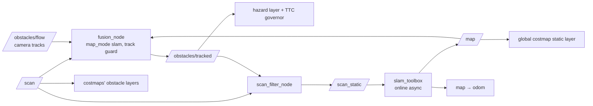

# Dynamic hybrid SLAM: an online map that people do not end up in

The navigation stack (`stack:=navigation`) has no pre-built map: slam_toolbox builds the map from the lidar while
the robot drives and localises the robot in it. The lidar–camera fusion of `hazards:=fused` ([hybrid.md](hybrid.md))
supplies tracks with velocities, and they are used twice:

1. for the hazard layer's risk cost and the time-to-collision governor;
2. with `scan_filter:=true`, to remove the beams that hit those tracks from the scan before SLAM sees it, so that a
   person walking past is not written into the map as a wall.

The fixed arena map is still used to score the runs (ground truth) and by the separate planner comparison
(`stack:=planning`, with AMCL); the navigation stack never reads it.



Without the filter, slam_toolbox reads the raw `/scan`. The costmaps and fusion always read the raw `/scan`:
the obstacle layers must see people, and fusion must see them to track them.

## Running it

```bash
ros2 launch rapid_nav_bringup sim.launch.py stack:=navigation hazards:=fused scan_filter:=true \
    scenario:=crossing controller:=dwb flow_backend:=farneback rtf:=0.25 headless:=true
ros2 run rapid_nav_tools nav_run --scenario crossing --controller dwb --hazards fused --scan-filter
```

In Docker: `scripts/dev.sh nav-smoke crossing dwb fused --rtf 0.25 --scan-filter`, and
`scripts/dev.sh experiment m4` for the matrix below.

| launch argument | values | meaning |
|---|---|---|
| `scan_filter` | `false` (default) | slam_toolbox maps the raw `/scan` |
| | `true` | slam_toolbox maps `/scan_static`, the scan without the fused tracks; needs `stack:=navigation` and `hazards:=fused` |

The launch rejects other combinations with an error, as it does for unknown values.

## Frames: why the spawn must be the default

slam_toolbox starts its `map` frame where `odom` starts, at the robot's spawn pose. The scenarios' goals
(`nav_scenarios.yaml`), the arena map that `nav_run` scores against, and the ground truth (`world`) are all in the
arena frame. The two frames are the same only when the robot spawns at (0, 0, 0), the default. Anything else would
send every goal to the wrong place, so `sim.launch.py` refuses to start `stack:=navigation` with another `x`, `y` or
`yaw`.

`nav_run` checks the same thing at run time. Before the first goal it waits for `/map`, then
compares the robot's `map ← base_footprint` pose with the ground truth. If they differ by more than 0.3 m or 0.2 rad
it exits with status 2 and says why. The ground truth is read only by `nav_run`: nothing in the stack uses it.

The camera side uses the same frames: `flow_tracker` removes the ego-motion with the TF pose `map ← camera` at each
depth stamp, which slam_toolbox's `map` frame provides. One change was needed to make those lookups succeed, and
the navigation stack makes it: `flow_tracker` runs with `tf_listener_node: dedicated`.

**Why.** By default the tracker's TF listener spins the tracker's own node in a second executor. The lookup at the
newest depth stamp usually needs one more EKF transform (about 7 ms of sim time; the EKF runs at 50 Hz). While
`on_frame` waits for it, no new `/tf` reaches the buffer, so every lookup timed out. In the first SLAM runs the
tracker dropped 400 of 401 frames, fusion got no camera track, and "fused" was the lidar alone. Measured on a running
SLAM stack with the robot driving, the same tracker used 0 of 145 frames with the shared node and 405 of 405 with a
dedicated one. Fusion is not affected: scan stamps are older, so their transforms are already in the buffer.

The node's own default stays `shared`; only the navigation stack's launch sets `dedicated`.

## slam_toolbox

`async_slam_toolbox_node` runs with `config/slam.yaml` (package `rapid_nav_navigation`). That file is
slam_toolbox 2.8.5's `mapper_params_online_async.yaml` with these changes. They were chosen once and not tuned.

| parameter | slam_toolbox | ours | why |
|---|---|---|---|
| `map_update_interval` | 5.0 s | 1.0 s | the planner's costmap and fusion's static mask see new walls sooner |
| `max_laser_range`, `min_laser_range` | 20.0, 0.0 m | 12.0, 0.12 m | the lidar's range |
| `minimum_travel_distance`, `minimum_travel_heading` | 0.5 m, 0.5 rad | 0.3 m, 0.3 rad | the arena is small |
| `enable_interactive_mode`, `use_map_saver` | true | false | no RViz interaction; `nav_run` saves the map itself |

The node is a lifecycle node. The launch configures and activates it itself (the pattern of slam_toolbox's own
`online_async_launch.py`), outside Nav2's lifecycle manager, which waits for a bond that slam_toolbox does not
offer. The manager runs the planner, controller, behaviour and BT servers. The global costmap's static layer reads slam_toolbox's `/map` (transient local). The map grows, and every
planner allows unknown cells.

## The dynamic scan filter

`scan_filter_node` (package `rapid_nav_perception`; the geometry is in `scan_filter.py`, without ROS) takes `/scan`
and the latest `/obstacles/tracked`. For each scan:

1. It keeps the tracks no older than `max_age` (0.5 s) and at least `min_speed` fast (0: every confirmed track, so
   a person who stops stays out of the map too).
2. It moves each track to the scan stamp: centre `p + v·dt`, and `σ(dt) = sqrt(σp² + (σv·dt)²)` from the track's
   position and velocity sigmas.
3. It removes every beam whose end point lies within `min(radius + margin + k·σ, max_radius)` of a predicted centre.
   The defaults are margin 0.10 m, k 2.0 and max_radius 0.8 m. The cap keeps an uncertain track from erasing a wall.
4. It publishes the scan on `/scan_static` with the same header and beam count.

**Why NaN.** A removed beam becomes NaN, not "no return". slam_toolbox's Karto skips NaN readings for both the hit
and the ray clearing (`karto_sdk/Karto.h`, `RayTrace` and the occupancy update, at lines 6169 and 6871 of the
installed header). A reading beyond the range would instead clear every cell along the beam, which would erase the
wall behind the person.

**Frames.** The tracks are in `map`, and the beams in the laser frame at the scan stamp. The node composes the
latest `map → odom` with `odom → laser` at the scan stamp (`lookup_transform_full`, fixed frame `odom`), so it never
waits for the `map → odom` that slam_toolbox computes from this very scan. Without that transform it publishes the
raw scan and counts it (`no_tf` in its log line). Without any fresh track it republishes the scan unchanged, with no
TF lookup.

| parameter | default | meaning |
|---|---|---|
| `margin`, `k_sigma`, `max_radius` | 0.10, 2.0, 0.8 | removal radius = min(radius + margin + k σ, max_radius) (m) |
| `min_speed`, `max_age` | 0.0, 0.5 | the tracks used (m/s, s) |
| `scan_topic`, `tracks_topic`, `output_topic` | `/scan`, `/obstacles/tracked`, `/scan_static` | topics |
| `fixed_frame`, `tf_timeout` | `odom`, 0.05 | TF |

## Fusion on a growing map

`fusion_node` drops the scan points near occupied cells of `/map` and clusters the rest. A SLAM map differs from a
fixed one in three ways, and `map_mode: slam` (which the navigation stack sets) handles them:

- **It changes.** The static mask is rebuilt on every map update. Origin and size change as the map grows.
- **It has unknown cells.** A wall the lidar has just reached is unknown until the next map update. In slam mode a
  point is a mover candidate only if its cell is known to be free (0 ≤ value < 25); occupied, near-occupied and
  unknown cells count as static. A person walking into space the robot has already seen is tracked at once. A person
  standing in unseen space is not tracked until that space is mapped.
- **It can absorb a mover.** Without the scan filter, a person who walks slowly or stands still is written into the
  map, their cells become occupied, and the static mask would then hide them from fusion. The **track guard**
  (`track_guard: true`, set by the navigation stack) keeps the scan points within the radius + 0.15 m of any confirmed
  track faster than 0.2 m/s, even on occupied cells. A track that is already being followed survives the ghost wall it
  leaves; a new one is not started there.

`map_mode: fixed` (the node's default) treats `/map` as a fixed map; the launch uses it only if `hazards:=fused` runs
without the navigation stack.

## Measures

`nav_run` adds the following to every bundle, which is named
`nav_run_<scenario>_<controller>[_<hazards>][_filter]_<time>`:

- **SLAM trajectory error.** Every 10 Hz sample also records `map ← base_footprint` from TF (`map_pose`). Per goal
  (`slam_error`) and for the whole run (`slam.trajectory`), it compares that pose with the ground truth at the same
  sample: ATE RMSE, maximum, final error and mean yaw error.
- **Map quality.** The last `/map` is saved as `slam_map.pgm` and `slam_map.yaml` and resampled onto the ground-truth
  arena map, with the boxes of the `unmapped` scenario added as true walls (`map_quality.py`, without ROS). The scores
  use a 0.10 m tolerance:
  - precision: the share of SLAM occupied cells near a true occupied cell;
  - recall: the share of the observable true wall cells (occupied, next to a cell that is free in truth and known to
    SLAM) that SLAM has within the tolerance. Walls SLAM never faced do not count against it;
  - ghost cells: SLAM occupied cells far from every true wall;
  - mover ghost cells: the ghost cells within the obstacle radius + 0.15 m of a moving obstacle's true track. These
    are the ghost walls left by people and carts.

  The scores are computed twice: in the map frame as it is (`identity`), and after the best rigid motion within
  ±0.20 m and ±3° (`aligned`). That separates the drift of the map frame from the content of the map.
  `slam_map_<scenario>.png` draws the result: true walls grey, matched cells green, ghosts red, mover ghosts magenta.

`summary.md` gets a SLAM section, and `experiment_report` gets a SLAM table (means per cell of ATE, precision, recall,
ghost cells and mover ghost cells).

## The matrix m4

`src/rapid_nav_tools/config/experiments/m4.yaml`: crossing, head_on and crowd × dwb × three conditions × 3 repeats at
RTF 0.25 (27 runs, about 6 h in Docker). A matrix word names the condition:

| word | hazards | scan filter |
|---|---|---|
| `off` | off | no |
| `fused` | fused | no |
| `fused_filter` | fused | yes |

`rapid_nav_tools.experiments.condition()` maps a word to the launch arguments (any hazards word works, and
`fused_filter`). `run_matrix.sh` gets the `nav-smoke` arguments from `experiments nav-args <word>`. The paired
comparisons are `fused` against `off`, `fused_filter` against `fused`, and `fused_filter` against `off`.

## First results

One run per condition, `crossing` with `dwb`, native on the development machine (Ubuntu 24.04, 16 CPUs, no GPU),
Farnebäck flow, target RTF 0.25 (measured 0.25). Times are in simulated seconds. Every scenario-validity row passes.
This is a smoke test, not the m4 matrix: one run per row cannot rank anything.

| condition | goals (truth) | collisions | min clearance (m) | ATE RMSE / max (m) | precision | recall | ghost cells | mover ghost cells | bundle |
|---|---|---|---|---|---|---|---|---|---|
| fused | 3/3 | 0 | 0.172 | 0.010 / 0.024 | 0.971 | 0.995 | 30 | 30 | `nav_run_crossing_dwb_fused_20261125-224943` |
| fused + scan filter | 3/3 | 0 | 0.283 | 0.006 / 0.018 | 0.991 | 0.993 | 9 | 9 | `nav_run_crossing_dwb_fused_filter_20261125-225303` |
| fused + scan filter (repeat) | 3/3 | 0 | 0.382 | 0.007 / 0.019 | 0.985 | 0.998 | 15 | 15 | `nav_run_crossing_dwb_fused_filter_20261125-231517` |

Map scores are the `aligned` row; the alignment found was at most 0.05 m, and identity and aligned agree to 0.001.

- **Every ghost cell came from the walker.** Without the filter the map holds two ghost arcs: one where the walker
  stood at its start until goal 2, and one where it stopped at y = 0.8. With the filter the second arc is gone (the
  stopped walker is still a confirmed track, and `min_speed` is 0). The first arc stays: the walker stood still from
  the start, so it was never tracked (see Known limits). The scan filter removed 5883 beams in 283 of 515 scans.
- **Runs vary.** The repeat with the filter left 15 mover ghost cells, against 9 in the first; that spread is why m4
  has repeats.
- **The trajectory is not hurt.** ATE stays at 1 cm in both runs. The arena has enough static structure for scan
  matching, and the filter removes only beams on the walker.
- **The camera path had to be fixed first.** Earlier runs of both conditions had no camera input (see the frames
  section: the tracker's TF waits). In those lidar-only runs the filter already cut the mover ghosts from 30–31 to 13.
  With the camera they went from 30 to 9.
- One earlier lidar-only run without the filter reached 2 of 3 goals: Nav2 aborted goal 3 after 5.1 s (error code
  102). The cause was not investigated; that bundle was discarded with the other lidar-only runs.

## Known limits

- A person who stands still in unseen space from the start is never seen moving, so it is mapped. That is SLAM
  without semantics; the filter only knows what fusion tracks.
- The filter acts on a confirmed track. Until fusion confirms a mover (3 lidar updates), its first scans reach SLAM.
  slam_toolbox only adds a scan after 0.3 m or 0.3 rad of travel, so few of them do.
- Karto clears a cell slowly: a cell stays occupied while at least 10 % of the beams through it hit
  (`occupancy_threshold` 0.1, `min_pass_through` 2). A ghost wall, once made, survives many later scans through it.
- The spawn must be (0, 0, 0) (see Frames). An arbitrary spawn would need a known `world → map` offset, which
  SLAM does not have.
